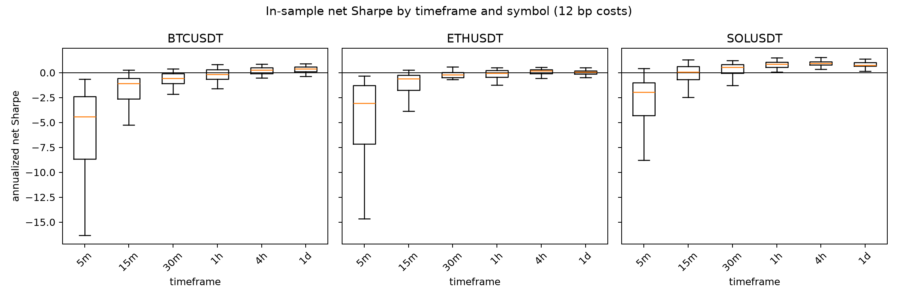
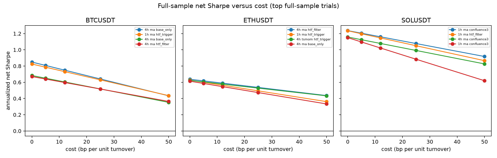
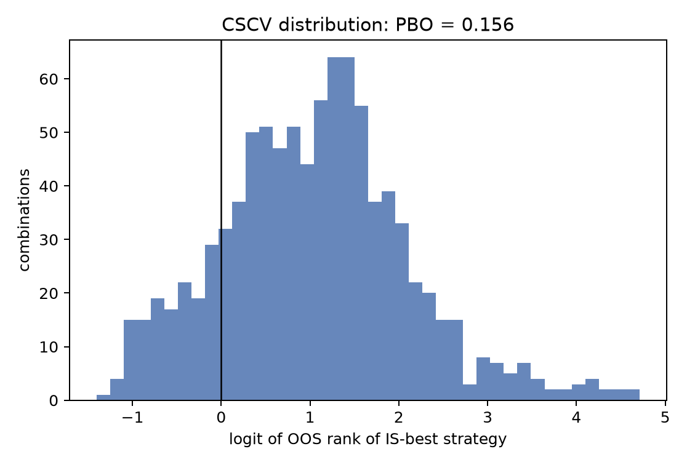
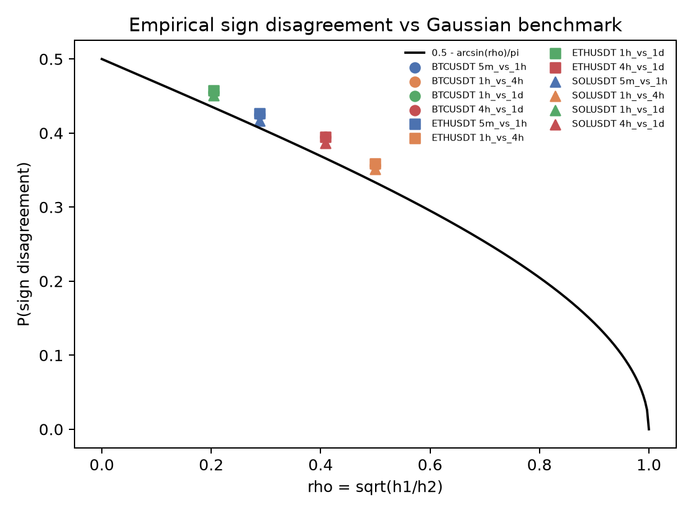
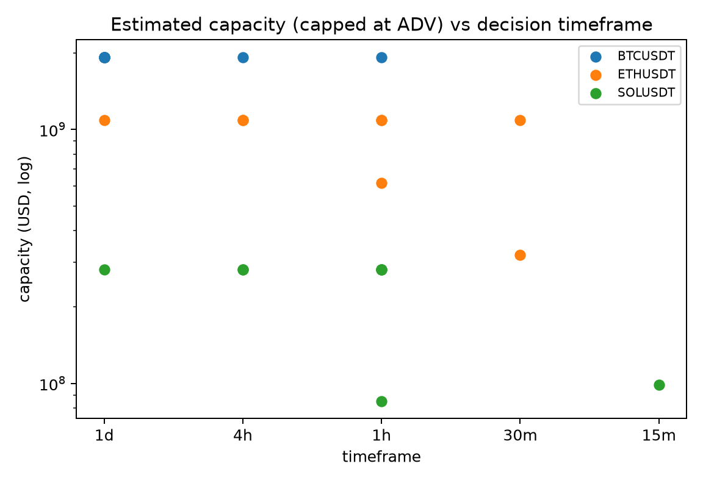
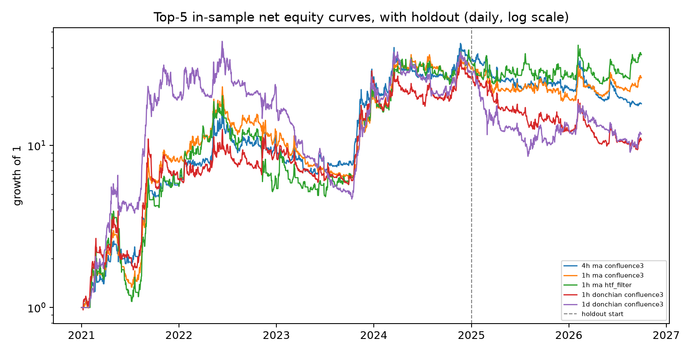
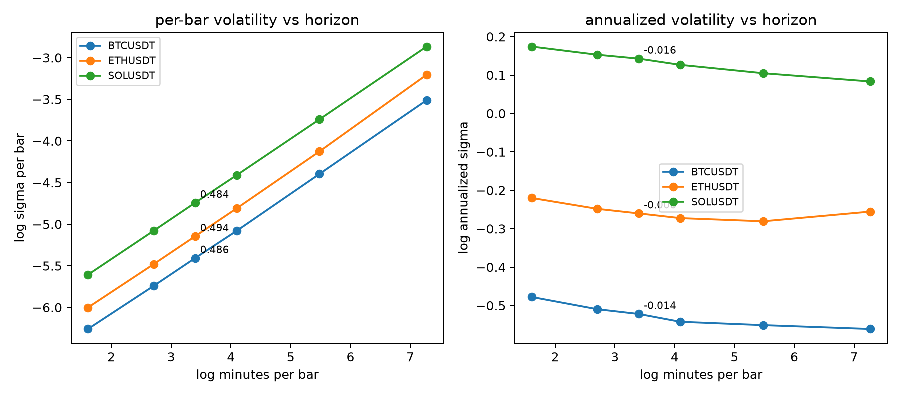

<div align="center">

# Timeframe Is a Parameter, Not a Truth

### The pre-registered, cost-aware study that explains why most “best timeframe” advice fails in the real world.

**1,008 strategies · 3 crypto assets · 6 timeframes · 5.75 years · one untouched holdout**

[](tests)
[](pyproject.toml)
[](LICENSE)
[](results/stats.json)
[](results/stats.json)
[](CITATION.cff)

[One-minute summary](#one-minute-summary) · [Evidence](#the-evidence-in-one-screen) · [Beginner guide](#-beginner-guide--read-this-and-you-are-a-professional) · [Playbook](#the-playbook-use-this-tomorrow) · [Interactive preview](preview.html) · [Technical paper](docs/PAPER.md)

</div>

> **If you remember one sentence:** choose the slowest timeframe that still lets you make the decisions you need, then prove the edge on data the strategy has never seen.

**This repository does not sell a profitable trading strategy. It sells a way to avoid believing a false one.**

---

## One-minute summary

**The question.** Does moving from 5-minute candles to 4-hour or daily candles actually improve a trading strategy, or does it only make the backtest look calmer?

**What we did.** We pre-registered 1,008 strategies across Bitcoin, Ethereum, and Solana; six timeframes from 5 minutes to 1 day; fourteen strategy configurations; and four execution variants. We charged realistic costs, kept a 21-month holdout completely untouched, and corrected for the fact that testing 1,008 ideas almost guarantees a few lucky winners.

**What we found.** Costs, not sampling noise, decide the timeframe. The median 5-minute strategy had a positive gross Sharpe ratio of **+0.244** but a net Sharpe ratio of **−3.207**. The best in-sample strategy looked excellent on paper — **1.54 Sharpe**, **+139% annualized** — and then lost money on the untouched holdout: **−0.50 Sharpe**, **−29% annualized**.

**Why it matters.** A beautiful backtest is not evidence of an edge. It is a hypothesis. After accounting for 1,008 trials, the deflated Sharpe probability of the winner was effectively zero, and every one of the 214 statistically significant holdout results was negative.

**What to do.** Pick the slowest operating cadence that preserves your decision budget. Charge costs before you celebrate. Count every idea you tried. Reserve a final exam the strategy has never seen. Treat multi-timeframe filters as risk controls, not as alpha.

<div align="center">

| 1,008 | 0 / 214 | 15.6% | −3.21 → +0.39 | 3 / 10 | 12 bp |
|---:|---:|---:|---:|---:|---:|
| strategies tested | positive significant OOS results | probability of backtest overfitting | median net Sharpe, 5m → 4h | top-10 OOS winners | live venue gap |
| **one** | **untouched** | **pre-registered** | **cost-aware** | **reproducible** | **auditable** |
| question | holdout | protocol | verdict | pipeline | evidence |

</div>

### The 30-second version

- **Timeframe is not a strategy.** It is an operating decision about how often you pay costs, measure risk, and act.
- **Higher timeframes do not remove risk.** Annualized volatility is roughly flat. What changes is how often you pay the toll.
- **The cost cliff is brutal.** Median annual return drag falls from **80.1 percentage points** at 5 minutes to **0.8 points** at 1 day.
- **The best backtest is usually a selection artifact.** The top in-sample strategy collapsed on the holdout; the top decile by in-sample Sharpe lost **−0.191 Sharpe** out of sample on average.
- **Multi-timeframe confirmation helps — but as risk control.** Filters and confluence improve average net Sharpe mainly by cutting volatility and turnover, not by creating gross alpha.
- **A decision budget changes the answer.** Bitcoin always preferred daily bars; Ethereum and Solana shifted toward faster bars when more trades per week were allowed.

---

## Who this is for

This repository is written for people who need to make or challenge a claim about trading timeframes:

- **Executives and board members** deciding whether to fund a systematic strategy.
- **Prop traders and portfolio managers** choosing an operating cadence.
- **Retail traders** trying to understand why a 5-minute chart feels profitable but the account does not.
- **Brokers, exchanges, and data vendors** explaining cost, turnover, and execution quality.
- **Fintech product teams** building a backtest reality check, a cost estimator, or an investor-education feature.
- **Risk, compliance, and model-validation teams** who need an audit trail for a trading claim.
- **Quant researchers and academics** who want a pre-registered, multiple-testing-aware benchmark.
- **Teachers, students, and content creators** who want a worked example of honest empirical finance.
- **Software engineers** who want a compact, tested reference implementation of a research pipeline.
- **Anyone shopping for a strategy, course, or signal service** who wants a checklist before paying.

You do not need a finance degree. The beginner guide below defines every term from scratch.

---

## What you can use this repository for

| Use case | What you get | How to use it |
|---|---|---|
| **Challenge a “best timeframe” claim** | A pre-registered test across six timeframes and three assets | Ask whether costs, trial count, and an untouched holdout were included. |
| **Estimate the cost of speed** | Median cost drag and turnover by timeframe | Compare a proposed cadence with the cost curve in Section 1. |
| **Choose an operating cadence** | A decision-budget framework (TBMT) | Start with the number of decisions you can genuinely make per week. |
| **Screen a vendor or signal service** | A checklist of the questions most vendors hope you will not ask | Use the ten questions in the beginner guide. |
| **Train a trading team** | A compact case study in selection bias and cost realism | Run the interactive quiz in `preview.html` as a workshop. |
| **Build a model-risk review** | Pre-registration, deviations log, holdout rule, and machine-readable artifacts | Reuse the protocol and artifact structure for an internal review. |
| **Audit a backtest** | DSR, PBO, Reality Check, SPA, and Benjamini–Hochberg results | Ask for the same statistics before allocating capital. |
| **Teach empirical finance** | A complete, reproducible worked example | Use the paper, figures, and quiz as course material. |
| **Prototype a fintech feature** | A working “reality check” data model and UI narrative | Adapt the evidence explorer and quiz to your product. |
| **Publish research** | A citable, versioned, MIT-licensed artifact | Cite the repository and the technical paper. |
| **Benchmark data quality** | Row counts, gaps, duplicates, and spread estimates | Compare your feed with the audit in Section 8. |
| **Sell or license a research tool** | MIT terms permit commercial use and sale with notice | Keep the copyright and license notice; no warranty is provided. |

### What this repository is not

- **Not financial advice.** Nothing here is a recommendation to buy or sell any asset.
- **Not a live trading system.** The live component is a read-only venue and signal check.
- **Not a profitability promise.** The holdout result is deliberately unflattering.
- **Not a universal law of markets.** The evidence covers three crypto pairs, four US equities, and one historical window.
- **Not a substitute for your own costs.** Your fees, slippage, taxes, and capacity will differ.
- **Not a reason to ignore risk.** A slower timeframe can still lose money, and often does.

---

## The one chart to remember



**Figure 1.** In-sample net Sharpe ratio for all 168 trials at each timeframe. The 5-minute and 15-minute distributions sit far below zero. The 4-hour and daily distributions are the only ones with positive medians. The pattern is about costs, not about a magic candle size.

If you read only one chart, read this one. Then read the next section to see why the winner at the top of the 4-hour distribution is still not a strategy you should fund.

---

<a id="-beginner-guide--read-this-and-you-are-a-professional"></a>

## 🌱 Beginner guide — read this and you are a professional

This section assumes **zero finance background**. If you already know the terms, skip to [the evidence](#the-evidence-in-one-screen). If you do not, read this once and you will know more than most interview candidates.

### 1. What is a timeframe?

A timeframe is how often you look at the market and make a decision.

- A **5-minute timeframe** means you get a new decision every five minutes.
- A **4-hour timeframe** means you get six decisions per day.
- A **daily timeframe** means you get one decision per day.

Think of a restaurant. A 5-minute timeframe is a manager checking every table every five minutes. A daily timeframe is a manager reviewing the day’s sales once. The daily manager makes fewer decisions, pays less attention cost, and may miss fast problems. The 5-minute manager catches more detail but spends the whole day walking the floor.

**There is no free lunch.** Faster decisions give you more chances to act, and more chances to pay.

### 2. What is a trading signal?

A signal is a rule that converts price history into a position.

Example: “If the 20-day average price is above the 100-day average price, hold the asset. Otherwise, hold cash.”

That rule is a **strategy**. The timeframe tells you how often the rule is allowed to speak. The same rule can be tested on 5-minute bars or daily bars. It is the same idea with a different operating rhythm.

### 3. What is a Sharpe ratio?

The Sharpe ratio divides return by wobble:

```text
Sharpe = return ÷ volatility
```

A Sharpe of **1.0** means the strategy earned about one unit of return for every unit of risk. A Sharpe of **−3.0** means it lost money while still wobbling. A higher Sharpe is generally better, but a high Sharpe from a short, lucky sample is not proof of skill.

**Gross Sharpe** ignores trading costs. **Net Sharpe** subtracts them. The gap between the two is where most fast strategies die.

### 4. What is drawdown?

Drawdown is the fall from a previous peak to a later trough.

If an account goes from **$100** to **$60**, the drawdown is **−40%**. A strategy can have a positive average return and still produce a drawdown that forces an investor to quit. The best in-sample strategy here had a **−60%** in-sample drawdown. That is not a smooth ride.

### 5. What is turnover?

Turnover measures how much trading the strategy does.

High turnover means you enter and exit constantly. Every entry and exit can incur a spread, commission, slippage, or market impact. A strategy with a tiny edge and enormous turnover is a machine for donating money to intermediaries.

At 5 minutes, the median strategy turned over **1,991 times per year**. At 1 day, it turned over **7.2 times per year**.

### 6. What are trading costs?

Costs are the tolls you pay to trade:

- **Spread:** the gap between the best buy and sell price.
- **Commission:** the fee your broker charges.
- **Slippage:** the difference between the price you expected and the price you got.
- **Market impact:** the price move your own order causes.
- **Funding and financing:** the cost of carrying a position.

This study uses a base cost of **12 basis points per unit of turnover**. One basis point is **0.01%**. Twelve basis points is **0.12%**. That sounds small. It is not small when you pay it thousands of times per year.

### 7. What is a backtest?

A backtest is a simulation of a strategy on historical data.

It is a **practice exam**, not the final exam. The strategy sees the questions and the answers at the same time. That makes it easy to accidentally memorize the past instead of learning a repeatable pattern.

### 8. What is overfitting?

Overfitting is when a strategy learns the noise in the past rather than a durable signal.

A student who memorizes the answers to last year’s exam may score 100% on that exam and fail a new one. A strategy that is tuned to one historical path can look brilliant in-sample and break immediately out of sample.

The more ideas you try, the more likely one of them will look brilliant by luck. That is why this study counts **1,008 trials** instead of reporting only the winner.

### 9. What is out-of-sample testing?

Out-of-sample (OOS) testing is the final exam.

You develop on an **in-sample (IS)** period, then evaluate once on a later period the strategy has never seen. This study used:

- **In-sample:** 1 January 2021 to 31 December 2024.
- **Out-of-sample:** 1 January 2025 to 30 September 2026.

The holdout was not used to tune the strategy, choose the timeframe, or pick the winner. It was opened once, after the rules were locked.

### 10. What is PBO?

PBO stands for **Probability of Backtest Overfitting**.

It estimates the chance that the best in-sample strategy will perform worse than the median strategy out of sample. A PBO of **15.6%** means the winner is not guaranteed to be a winner. It is better than a coin flip, but it is not a certificate of quality.

PBO is one diagnostic, not a verdict. A low PBO does not rescue a strategy that fails on costs or on a holdout.

### 11. What is the Deflated Sharpe Ratio?

The Deflated Sharpe Ratio (DSR) adjusts a Sharpe ratio for:

- how many strategies you tried,
- how long the sample is,
- skewness and fat tails,
- and the fact that you selected the best result.

If you try 1,008 ideas, the best one will look better than it really is. DSR asks: after accounting for that search, is the result still impressive?

Here, the **maximum DSR across all 1,008 trials** was **1.36 × 10⁻⁹¹**, and the best in-sample trial’s own DSR was **8.16 × 10⁻⁹⁶**. Both are effectively zero. The backtest did not survive the correction.

### 12. What are Reality Check and SPA?

The **Reality Check** and **Superior Predictive Ability** tests ask whether the best strategy is better than what you would expect from data snooping across many strategies.

Their p-values here were **0.246** and **0.210**. Both are above the usual 0.05 threshold. In plain English: the evidence is not strong enough to rule out luck.

### 13. What is a multi-timeframe filter?

A multi-timeframe filter uses a slower chart as a permission slip.

Example: “Only take a 1-hour signal if the daily trend is positive.”

The idea is intuitive: trade with the bigger tide, not against it. The study finds that filters improve average net Sharpe, but mostly by reducing volatility and turnover. They are **risk controls**, not a secret source of extra return.

### 14. What is confluence?

Confluence requires several signals to agree before you act.

Example: “Go long only if the moving-average signal, the momentum signal, and the higher-timeframe filter all say yes.”

Confluence made the average strategy look better in this study. It also made the strategy trade less and wobble less. That is useful. It is not the same as creating alpha.

### 15. What is a decision budget?

A decision budget is the number of trades or decisions you can realistically make in a given period.

A person with a full-time job cannot monitor 5-minute bars all day. A fund with a large position cannot trade thousands of times per year without moving the market. The best timeframe is the slowest one that still fits the decisions you actually need to make.

### 16. What is capacity?

Capacity is how much money a strategy can manage before its own trades move the price against it.

A strategy that works with **$10,000** may fail with **$100 million**. This repository reports capacity as an **upper bound**, not a promise. Twenty of twenty-four capacity rows were capped by the available data, which means the true limit could be lower.

### How to read a results table

When you see a table in this repository, ask four questions:

1. **What is the sample?** More data is not automatically better, but a short sample is fragile.
2. **Are costs included?** Gross Sharpe is a marketing number. Net Sharpe is an operating number.
3. **How many ideas were tried?** A winner from one trial and a winner from 1,008 trials are different claims.
4. **Was there a holdout?** If every observation was used to tune the strategy, the result is a hypothesis, not evidence.

### Ten questions to ask any strategy salesperson

1. What is the exact timeframe, and why that timeframe?
2. What are the all-in costs per turn, including spread, commission, slippage, and impact?
3. How many strategy variants were tested before this one was selected?
4. What happened on data that was never used for tuning?
5. What is the drawdown, and how long did it last?
6. What is the turnover, and who can execute it at that speed?
7. Does the edge survive at two or three times the assumed cost?
8. How does the strategy behave in a different asset or market regime?
9. What would make you conclude that the strategy is broken?
10. Can I see the pre-registration, the trial count, and the full artifact set?

If the answer to question 10 is no, treat the rest as a story.

### Your 10-minute, 90-minute, and one-day path

| Time | Read | Outcome |
|---|---|---|
| **10 minutes** | This summary and Figure 1 | You can explain why fast timeframes lose to costs. |
| **30 minutes** | The beginner guide and the evidence tables | You can challenge a “best timeframe” claim. |
| **90 minutes** | The playbook and the technical paper | You can design a cost-aware, pre-registered test. |
| **One day** | Reproduce the tests and inspect the artifacts | You can audit the result yourself. |

**After this guide, you will know more than most interview candidates.** Not because you memorized a formula, but because you understand the three things that separate a backtest from evidence: **costs, trial count, and an untouched holdout.**

---

## The experiment, in plain English

| Question | Design choice |
|---|---|
| **Assets** | Bitcoin (BTC/USDT), Ethereum (ETH/USDT), Solana (SOL/USDT); four US equities (AAPL, TSLA, AMZN, VTI) in a separate extension. |
| **Timeframes** | 5m, 15m, 30m, 1h, 4h, 1d. |
| **Strategies** | Moving-average crossover, time-series momentum, and Donchian breakout. |
| **Variants** | Base strategy, higher-timeframe filter, higher-timeframe trigger, and three-signal confluence. |
| **Grid** | 3 crypto assets × 6 timeframes × 14 configurations × 4 variants = **1,008 trials**. |
| **Sample** | 1 January 2021 to 30 September 2026; **1,461** in-sample days and **638** holdout days. |
| **Costs** | 12 bp round-trip cost per unit of turnover, charged at the decision bar. |
| **Execution** | Position decided at the close, effective from the next bar’s open; no look-ahead. |
| **Primary test** | Deflated Sharpe Ratio, Probability of Backtest Overfitting, Reality Check, SPA, and Benjamini–Hochberg. |
| **Holdout rule** | Opened once after the protocol was locked. No symbol dropped, no timeframe added, no winner re-tuned. |
| **Reproducibility** | Fixed seed, pinned environment, machine-readable artifacts, automated tests, Docker. |

The equity extension is deliberately smaller: **80 daily rows** (64 daily and 16 weekly), with an exploratory **83-day** intraday window that is not used for annualized claims. The crypto study is the main event.

---

## The evidence in one screen

| Finding | Verified result | What it means |
|---|---:|---|
| **Costs dominate at high frequency** | Median net Sharpe: **−3.207** at 5m vs **+0.387** at 4h | The same kind of rule goes from terrible to respectable when you stop paying the toll every five minutes. |
| **Gross can be positive while net is negative** | 5m median gross **+0.244**, net **−3.207** | A backtest without costs is not an operating result. |
| **The best in-sample trial collapsed** | IS **1.54 Sharpe**, OOS **−0.50** | Selection found a historical winner, not a durable edge. |
| **Deflation kills the winner** | Max DSR **1.36 × 10⁻⁹¹**; winner DSR **8.16 × 10⁻⁹⁶** | After 1,008 trials, no result is distinguishable from luck. |
| **Overfitting risk remains material** | PBO **15.6%** | About one in six winners of this kind would be expected to underperform the median OOS strategy. |
| **Data snooping is not rejected** | Reality Check p **0.246**; SPA p **0.210** | The best result is within the range one would expect from searching. |
| **Significant does not mean profitable** | **237** IS significant; **232** negative. **214** OOS significant; **214** negative. | The search reliably found statistically detectable losers. |
| **The top decile lost money** | OOS mean **−0.191 Sharpe**; **30.7%** positive | Ranking by in-sample Sharpe did not transfer to the holdout. |
| **Rank correlation is misleading** | Overall Spearman **0.709**; among IS winners **−0.030** | The overall number is driven by obviously bad strategies, not by skill among the contenders. |
| **Overlays help on average** | HTF filter: **+0.527** mean net Sharpe; confluence: **+0.936** | Useful risk controls, but the improvement is mostly lower volatility and turnover. |
| **Decision budget changes the answer** | ETH/SOL optimal timeframe shifts; BTC stays daily | There is no universal “best timeframe” without a trading budget. |
| **Live plumbing works** | 3 venues, **12.0 bp** max gap, hash chain valid | The operational check is sound; the signal is not yet a proven strategy. |

---

## 1. Costs decide the timeframe

This is the central result. The table below reports all 168 crypto trials at each timeframe.

| Timeframe | n | Mean IS net SR | Median IS net SR | Median gross SR | Median cost drag (annual return) | Median turnover/yr |
|---|---:|---:|---:|---:|---:|---:|
| 5m | 168 | −5.375 | **−3.207** | +0.244 | **0.801** | 1,991.5 |
| 15m | 168 | −1.363 | −0.596 | +0.326 | 0.511 | 603.2 |
| 30m | 168 | −0.392 | −0.111 | +0.384 | 0.312 | 291.8 |
| 1h | 168 | +0.101 | +0.175 | +0.431 | 0.168 | 143.8 |
| 4h | 168 | +0.414 | **+0.387** | +0.447 | 0.039 | 27.8 |
| 1d | 168 | +0.385 | +0.347 | +0.273 | **0.008** | **7.2** |

### How to read this table

- **Gross SR** is the strategy before trading costs. It is broadly similar across timeframes, especially from 15 minutes to 4 hours. The signal does not suddenly become brilliant on a 4-hour chart.
- **Net SR** subtracts costs. The 5-minute median falls from **+0.244** gross to **−3.207** net. That is a collapse of **3.45 Sharpe points**.
- **Cost drag** is the annualized return lost to trading. At 5 minutes, the median strategy gives up **80.1 percentage points** of annual return. At 1 day, it gives up **0.8 points**.
- **Turnover** explains the difference. The median 5-minute strategy turns over **1,991 times per year**. The median daily strategy turns over **7.2 times**.

The strict “the slower the better” rule is not exact. The 4-hour median (**+0.387**) is slightly above the daily median (**+0.347**), and 4-hour gross Sharpe (**+0.447**) is above daily gross (**+0.273**). That hump is a gross-signal effect, not a cost effect. The broad conclusion is still clear: **5m and 15m are structurally difficult, 1h is marginal, and 4h–1d is the cost-optimal region.**

### The out-of-sample picture is worse

Every timeframe has a negative median net Sharpe on the holdout:

| Timeframe | Median OOS net SR |
|---|---:|
| 5m | −3.843 |
| 15m | −1.095 |
| 30m | −0.638 |
| 1h | −0.382 |
| 4h | **−0.028** |
| 1d | −0.180 |

The 4-hour row is the **least negative**, not a profitable one. The correct reading is not “4-hour works.” It is “4-hour is where costs stop destroying the average strategy, and where a real edge would have the best chance of surviving.”



**Figure 2.** Full-sample cost sensitivity for the top trials. The vertical line marks the 12 bp base cost. This figure is explicitly full-sample and is not used for the holdout claim.

---

## 2. The winner is a warning, not a strategy

The best in-sample trial was:

```text
SOLUSDT | 4h | moving-average crossover | confluence3 | fast=10, slow=50
```

It looked excellent on the development data:

| Metric | In-sample | Out-of-sample |
|---|---:|---:|
| Sharpe ratio (net) | **1.54** | **−0.50** |
| Annualized return (net) | **+139.4%** | **−29.0%** |
| Annualized volatility (net) | 73.8% | 46.9% |
| Maximum drawdown | −60.1% | −52.9% |
| Days | 1,461 | 638 |
| Trades | 356 | — |
| Win rate | 44.7% | — |
| Profit factor | 2.02 | — |
| Break-even cost | 2.17% | — |

The in-sample result is not a smooth, safe edge. It made money while enduring a **−60%** drawdown, and it needed a **2.17%** break-even cost to survive. The assumed cost was **0.12%**. In other words, the strategy had a large cost cushion in the backtest, but it still failed on the holdout.

### The top ten did not transfer

| Rank | Trial | IS Sharpe | OOS Sharpe | OOS 95% CI |
|---:|---|---:|---:|---:|
| 1 | SOL 4h MA confluence3 10/50 | 1.542 | −0.498 | [−2.094, 0.727] |
| 2 | SOL 1h MA confluence3 50/200 | 1.485 | +0.092 | [−1.132, 1.149] |
| 3 | SOL 1h MA HTF filter 50/200 | 1.382 | +0.403 | [−0.805, 1.456] |
| 4 | SOL 1h Donchian confluence3 100 | 1.376 | −0.663 | [−1.974, 0.402] |
| 5 | SOL 1d Donchian confluence3 20 | 1.374 | −0.441 | [−1.634, 0.702] |
| 6 | SOL 1h MA confluence3 10/50 | 1.341 | −0.375 | [−1.826, 0.942] |
| 7 | SOL 15m MA confluence3 50/200 | 1.307 | −0.078 | [−1.441, 1.143] |
| 8 | SOL 4h MA confluence3 50/200 | 1.290 | −0.316 | [−1.587, 1.118] |
| 9 | SOL 4h MA HTF filter 10/50 | 1.286 | +0.035 | [−1.362, 1.207] |
| 10 | SOL 4h Donchian confluence3 100 | 1.279 | −0.817 | [−2.080, 0.292] |

**Three of the top ten were positive out of sample. None of the ten had a 95% confidence interval that excluded zero.** The best point estimate was **+0.403**, but its interval ran from **−0.805** to **+1.456**. That is not evidence you can fund. It is a range that comfortably includes “no edge.”

The top ten are also almost entirely Solana. That is a warning about concentration and selection, not a discovery about Solana.

### The statistical autopsy

| Diagnostic | Result | Plain English |
|---|---:|---|
| **Deflated Sharpe Ratio** | max **1.36 × 10⁻⁹¹**; winner **8.16 × 10⁻⁹⁶** | After 1,008 trials, no result is impressive. |
| **PBO** | **15.6%** | About one in six such winners would be expected to underperform the median OOS strategy. |
| **Reality Check p-value** | **0.246** | Cannot reject the null of no superior skill. |
| **SPA p-value** | **0.210** | Same conclusion under a different data-snooping test. |
| **BH-significant IS trials** | **237** (5 positive, 232 negative) | The search finds “significant” losers easily. |
| **BH-significant OOS trials** | **214** (0 positive, 214 negative) | On the holdout, every significant result is negative. |
| **Top IS decile OOS mean** | **−0.191 Sharpe** | Ranking by in-sample Sharpe did not pick winners. |
| **Top IS decile positive fraction** | **30.7%** | Fewer than one in three stayed positive. |
| **IS/OOS Spearman, all trials** | **0.709** | The overall ranking is informative because bad strategies stay bad. |
| **IS/OOS Spearman, IS winners only** | **−0.030** | Among the strategies that looked good, rank told you almost nothing. |



**Figure 5.** The PBO diagnostic. The winner is not automatically the strategy with the best expected out-of-sample performance.

### The selection trap

Suppose you test 1,008 strategies and pick the best one. The maximum of 1,008 noisy estimates is almost guaranteed to be above the true average, even if none of the strategies has skill. This is the **maximum selection** problem.

The DSR, PBO, Reality Check, and SPA are four different ways of asking the same question: **is the winner better than the best result we would expect from luck alone?** Here, the answer is no.

The practical rule is simple:

> **Never evaluate a winner without counting the losers that produced it.**

---

## 3. Multi-timeframe overlays are risk controls, not alpha

The study tested three overlays:

- **HTF filter:** only trade when the higher timeframe agrees.
- **HTF trigger:** use the higher timeframe as the trigger, with the faster timeframe for timing.
- **Confluence3:** require the base signal, the higher-timeframe filter, and a third signal to agree.

The preregistration expected the overlays to hurt. The data rejected that negative claim: on average, they helped. But the mechanism matters.

| Variant | Mean Δ net Sharpe (IS) | Median Δ net (IS) | % positive | Mean Δ gross | Vol ratio | Turnover ratio | Mean Δ net (OOS) | OOS % positive |
|---|---:|---:|---:|---:|---:|---:|---:|---:|
| HTF filter | **+0.527** | +0.287 | 80.6% | +0.066 | 0.803 | 0.620 | **+0.487** | 68.3% |
| HTF trigger | **+1.634** | +0.526 | 80.2% | +0.027 | 0.959 | 0.235 | **+1.782** | 73.0% |
| Confluence3 | **+0.936** | +0.458 | 83.7% | +0.127 | 0.680 | 0.432 | **+0.812** | 69.1% |

### What the table says

- **The average effect is positive.** That is a genuine empirical finding, and it survives out of sample on average.
- **The gross effect is small.** HTF filter adds only **+0.066** gross Sharpe. HTF trigger adds **+0.027**. Confluence adds **+0.127**.
- **The risk effect is large.** HTF filter cuts volatility to **0.803** of the base and turnover to **0.620**. Confluence cuts volatility to **0.680** and turnover to **0.432**.
- **The improvement is mostly a denominator effect.** Lower volatility and lower turnover make the net Sharpe ratio look better without creating much new gross return.

That is still valuable. A risk control that keeps you out of bad trades and reduces costs can improve a portfolio. But it is not the same as a new source of alpha, and it does not rescue the selected winner.

### The effect shrinks as the timeframe slows

| Timeframe | HTF filter mean Δ net | Confluence3 mean Δ net |
|---|---:|---:|
| 5m | +1.66 | +2.95 |
| 15m | +0.72 | +1.26 |
| 30m | +0.45 | +0.78 |
| 1h | +0.26 | +0.42 |
| 4h | +0.11 | +0.18 |
| 1d | −0.027 | +0.022 |

The overlay has the most room to help at high frequency, where the base strategy is noisy and expensive. By 4h and 1d, there is less noise and less turnover to remove. This is consistent with the risk-control interpretation.



**Figure 4.** Multi-timeframe disagreement. When fast and slow signals disagree, the decision to stand aside can reduce risk and turnover.

---

## 4. A decision budget changes the best timeframe

The “best timeframe” is not a property of the market alone. It depends on how many decisions you can make and how many trades your execution can support.

The **Timeframe Bottleneck / Decision Budget Test (TBMT)** asks: given a maximum number of trades per week, which timeframe should you choose?

| Asset | Unconstrained best | 21 trades/week | 42 trades/week | 168 trades/week | 336+ trades/week |
|---|---|---|---|---|---|
| BTC | 1d | 1d | 1d | 1d | 1d |
| ETH | 30m | 1d (regret 0.095) | 4h (regret 0.039) | 4h (regret 0.039) | 30m (regret 0) |
| SOL | 4h | 1d (regret 0.167) | 4h (regret 0) | 4h (regret 0) | 4h (regret 0) |

### What this means

- **Bitcoin is a daily decision.** Across every budget tested, the daily timeframe was the best feasible choice. Faster trading did not compensate for costs.
- **Ethereum and Solana are budget-sensitive.** When the budget is tight, daily or 4-hour bars win. When more trades are allowed, faster bars become viable.
- **Regret is largest at the tightest budget.** For SOL at 21 trades per week, choosing the unconstrained 4-hour optimum instead of the feasible daily optimum would cost **0.167 Sharpe**.
- **The practical rule:** choose the slowest timeframe that preserves the decisions you actually need. Do not choose a fast timeframe because it looks exciting, and do not choose a slow one because it feels safe.



**Figure 7.** Capacity estimates. These are upper bounds, not guarantees; 20 of 24 rows were capped by the available data.

---

## 5. Equities: the direction transfers, the certainty does not

The equity extension tests whether the crypto conclusions are crypto-specific. It uses four US equities and ETFs: **AAPL, TSLA, AMZN, and VTI**.

The sample is deliberately smaller:

- **80 daily rows** in total: 64 daily and 16 weekly.
- **83 days** of exploratory intraday data, not used for annualized claims.
- Costs are estimated with the Corwin–Schultz high-low spread estimator.

### Daily and weekly results

| Timeframe | n | Median net Sharpe | Median gross Sharpe | Median cost drag |
|---|---:|---:|---:|---:|
| Daily | 64 | **+0.367** | +0.369 | 0.0009 |
| Weekly | 16 | **+0.401** | +0.404 | 0.0003 |

Costs are much less damaging for daily and weekly equity strategies than for 5-minute crypto strategies. That is expected: lower turnover means fewer tolls.

### Overlay effects

| Variant | Pairs | Mean Δ net | Median Δ net | % positive | Mean Δ gross | Vol ratio | Turnover ratio |
|---|---:|---:|---:|---:|---:|---:|---:|
| HTF filter | 16 | **+0.248** | +0.273 | 93.8% | +0.246 | 0.709 | 0.520 |
| HTF trigger | 16 | **+0.295** | +0.343 | 81.3% | +0.287 | 0.903 | 0.127 |
| Confluence3 | 16 | **+0.335** | +0.360 | **100%** | +0.331 | 0.672 | 0.392 |

The direction is the same as in crypto: overlays help, and the help is mostly risk and turnover reduction. The sample is too small for a strong standalone claim, and many equity rows are buy-and-hold-like. Treat this as **supporting evidence**, not a second independent confirmation.



**Figure 6.** Equity extension. The direction transfers, but the sample is small and the intraday window is short.

---

## 6. Live check: the plumbing works, the signal does not agree

A research pipeline is not useful if it cannot connect to reality. The live component checks three public venues and records a hash-chained signal snapshot.

| Check | Result |
|---|---|
| Venues | Kraken, Coinbase, OKX |
| Prices | 83,253.00 / 83,249.47 / 83,349.40 |
| Maximum venue deviation | **12.0 bp** |
| Tolerance | 50 bp |
| Within tolerance | **Yes** |
| Timestamp | 2026-10-21T10:36:04Z |
| 1h signal | MA +1, TSMOM +1 |
| 4h signal | MA −1, TSMOM +1 |
| 1d signal | MA +1, TSMOM +1 |
| Aligned across timeframes | **No** |
| Distinct signs | 2 |
| Agreement count | 2 |
| Hash chain | **3 valid records** |

The operational check passes: the venues are close, the snapshot is internally consistent, and the log chain validates. The strategy check does not: the 1-hour, 4-hour, and daily signals do not agree. That is not a bug. It is the multi-timeframe disagreement problem in miniature, and it is exactly why a filter or a confluence rule changes behavior.

Three records are not enough to test whether the disagreement is informative. The live component is a **plumbing demonstration**, not a trading system.

---

## 7. What survives scrutiny

These are the claims the evidence supports, with the appropriate caveats:

1. **Costs rise sharply as the timeframe shortens.** The median cost drag falls from 80.1 percentage points at 5m to 0.8 at 1d.
2. **Net Sharpe improves from 5m to 4h.** The median goes from −3.207 to +0.387.
3. **Annualized volatility is roughly flat across timeframes.** The per-bar volatility slope is about 0.48–0.49, close to the square-root-of-time prediction of 0.5, but annualized volatility does not fall with slower bars.
4. **The 4h–1d region is the cost-optimal region.** It is not a guarantee of profit. Every timeframe had a negative median OOS Sharpe.
5. **Multi-timeframe filters and confluence help average net Sharpe.** The effect is robust in sign across crypto and equities, but it is mostly a volatility and turnover effect.
6. **The best in-sample trial fails out of sample.** IS 1.54 Sharpe and +139% annualized became OOS −0.50 and −29%.
7. **The winner does not survive multiple-testing correction.** The maximum DSR across all trials is 1.36 × 10⁻⁹¹; the winner’s DSR is 8.16 × 10⁻⁹⁶; Reality Check p = 0.246; SPA p = 0.210.
8. **Ranking by in-sample Sharpe is not a reliable selection rule.** The top decile lost 0.191 Sharpe on average, and only 30.7% of its members stayed positive.
9. **A decision budget changes the optimal timeframe.** BTC stays daily; ETH and SOL shift with the budget.
10. **The live plumbing and data audit are sound.** Venue deviation is 12 bp, the hash chain validates, and the crypto series pass monotonicity, duplicate, and price-integrity checks.

---

## 8. What does not survive scrutiny

These are the claims you should **not** make from this repository:

- **“4-hour is the best timeframe.”** It is the cost-optimal region in this sample, not a universal law. The median OOS Sharpe at 4h was still negative.
- **“Multi-timeframe filters create alpha.”** They improve average net Sharpe, but the gross effect is small and the mechanism is mostly lower volatility and turnover.
- **“The best strategy is profitable.”** It lost money on the holdout.
- **“The equity results prove the same thing.”** They point in the same direction, but the sample is small and partly buy-and-hold-like.
- **“The live system is ready to trade.”** It is a read-only venue and signal check with three records.
- **“Capacity is $X.”** Capacity is an upper bound and was clipped in 20 of 24 rows.
- **“Costs are 12 bp for everyone.”** Your costs depend on your venue, size, asset, and execution quality. Twelve basis points is a base case, not a promise.
- **“A high Sharpe ratio means the strategy is good.”** A high Sharpe from a short, selected, cost-free backtest is a red flag, not a green light.



**Figure 3.** Volatility scaling. Per-bar volatility rises with the square root of the horizon, but annualized volatility is approximately flat. Higher timeframes are not automatically less risky.

---

## The playbook: use this tomorrow

### If you are allocating capital

1. **Ask for the trial count.** If the strategy was chosen from many variants, demand a deflated Sharpe or equivalent correction.
2. **Ask for net returns.** Gross Sharpe is not an operating result.
3. **Ask for the holdout.** A backtest that has seen every observation is a hypothesis.
4. **Ask for the drawdown.** A high return with a −60% drawdown may be uninvestable.
5. **Ask for capacity.** A strategy that works at small size may fail at yours.
6. **Set a decision budget.** Choose the slowest cadence that preserves your required decisions.
7. **Paper trade before funding.** The live check is a start, not a finish line.
8. **Write down what would prove you wrong.** If nothing can falsify the thesis, it is a belief, not an investment.

### If you are building a strategy

1. **Write the protocol before looking at the holdout.** Include the asset list, timeframe list, cost model, and decision rule.
2. **Count every variant.** The trial count is part of the result.
3. **Charge costs at the decision bar.** Be conservative about execution.
4. **Use a final holdout once.** Do not peek, tune, and call it validation.
5. **Test across assets and regimes.** A single asset is a case study.
6. **Report the losers.** The distribution matters more than the winner.
7. **Prefer risk controls over clever filters.** Reducing volatility and turnover is more robust than adding another signal.
8. **Treat a large-grid winner as a hypothesis.** The next step is a new test, not a launch.

### If you are selling a strategy or course

1. **Show the trial count.** Hiding the search is the most common form of misleading backtest marketing.
2. **Show net returns and turnover.** If the edge disappears after costs, say so.
3. **Show the holdout.** A single untouched period is more credible than a thousand in-sample charts.
4. **Show the drawdown.** Do not sell only the equity curve’s best section.
5. **Explain the decision budget.** A strategy that requires 24/7 monitoring is a different product from a daily strategy.
6. **Publish the limitations.** Trust is built by what you admit, not by what you hide.

### The 30-second client pitch

> “We tested 1,008 strategies across six timeframes. The fast strategies looked fine before costs and fell apart after costs. The best backtest lost money on a holdout we never touched. The useful lesson is not a magic timeframe; it is a process: count your trials, charge your costs, reserve a final exam, and choose the slowest cadence that fits the decisions you actually need to make.”

---

## Features

| Feature | What it does |
|---|---|
| **Pre-registered protocol** | Locks the hypotheses, grid, costs, and decision rule before the holdout is opened. |
| **1,008-trial grid** | Tests three strategies, four variants, six timeframes, and three crypto assets. |
| **Cost-aware metrics** | Reports gross and net Sharpe, cost drag, turnover, break-even cost, and exposure. |
| **Multiple-testing suite** | DSR, PBO, Reality Check, SPA, and Benjamini–Hochberg. |
| **Untouched holdout** | 638 days of out-of-sample data, evaluated once. |
| **Equity extension** | Tests whether the direction transfers to US equities and ETFs. |
| **Decision-budget analysis** | Finds the best feasible timeframe under a trades-per-week constraint. |
| **Capacity analysis** | Estimates upper bounds and flags data-clipped rows. |
| **Multi-scale diagnostics** | Volatility scaling, Hurst exponents, mutual information, and surrogate tests. |
| **Live venue check** | Compares three public venues and records a hash-chained signal snapshot. |
| **Data audit** | Checks gaps, duplicates, monotonicity, price integrity, and spread estimates. |
| **Machine-readable artifacts** | JSON and CSV outputs for every major result. |
| **Publication figures** | Eight figures generated from the artifacts. |
| **Automated tests** | 20 tests covering metrics, statistics, and pipeline behavior. |
| **Docker and CI** | Reproducible environment and automated lint/test workflow. |
| **Interactive preview** | A self-contained HTML page with an evidence explorer and a quiz. |

---

## Quickstart

### Option 1: Read without installing anything

1. Read the [one-minute summary](#one-minute-summary).
2. Look at [Figure 1](figures/fig1_sharpe_by_timeframe.png).
3. Read the [beginner guide](#-beginner-guide--read-this-and-you-are-a-professional).
4. Open the [technical paper](docs/PAPER.md) for the full methods and results.

### Option 2: Open the interactive preview

```bash
python3 -m http.server 8000
```

Then open:

```text
http://localhost:8000/preview.html
```

The preview is a single self-contained HTML file. It has no build step, no CDN, and no external JavaScript. If you open it directly from GitHub, it may appear as source code; use the local server or GitHub Pages.

### Option 3: Run the tests

```bash
python3.12 -m venv .venv
source .venv/bin/activate
pip install -e ".[dev]"
pytest -q
ruff check src experiments tests
```

Expected result: **20 passed** and no lint errors.

### Option 4: Reproduce the full study

```bash
source .venv/bin/activate
make all
```

`make all` fetches public data, runs the audit, builds the backtests, computes the statistics, runs the equity and surrogate extensions, takes the live snapshot, generates the figures, and writes `results/report.json`.

The full run requires network access and may take a while. Raw data are cached under `data/cache/` and are not committed.

### Option 5: Use Docker

```bash
docker compose up --build research
```

For the optional live shadow logger:

```bash
docker compose --profile live up live-shadow
```

### Option 6: Regenerate the public preview

The preview is static and does not require a build. Edit `preview.html`, refresh the page, and update the committed screenshots or media only if the visible design changes. No framework, package install, or external library is required.

---

## Reproducibility and artifact map

The machine-readable report is `results/report.json`. If a hand-written sentence and an artifact disagree, **the artifact is authoritative**.

| Artifact | Contents |
|---|---|
| `results/report.json` | Top-level machine-readable report. |
| `results/stats.json` | DSR, PBO, RC, SPA, BH, variant effects, timeframe effects, top-IS CIs, descriptive top-OOS list. |
| `results/trials_with_dsr.csv` | All 1,008 trials with IS/OOS metrics and DSR. |
| `results/trials.parquet` | Raw trial return matrix. |
| `results/top_bootstrap_ci.csv` | Top-10 IS trials with OOS bootstrap intervals. |
| `results/timeframe_family.csv` | Per-symbol/timeframe best and median performance. |
| `results/capacity.csv` | Capacity estimates and ADV caps. |
| `results/tbmt.csv` | Decision-budget results. |
| `results/equities_daily.csv` | Daily and weekly equity results. |
| `results/equities_intraday.csv` | Exploratory intraday equity results. |
| `results/equity_effects.json` | Equity variant effects. |
| `results/live_snapshot.json` | Live venue and shadow-signal snapshot. |
| `results/live_shadow.jsonl` | Hash-chained live log (not committed). |
| `results/data_audit.json` | Data quality checks. |
| `results/multiscale.json` | Volatility scaling, Hurst, and mutual-information diagnostics. |
| `results/surrogates.json` | Surrogate tests for the finest-scale results. |
| `figures/fig1..fig8` | Publication figures. |
| `docs/PAPER.md` | Full technical paper. |
| `docs/METHODS.md` | Methods note. |
| `docs/DATA.md` | Data sources and audit notes. |
| `docs/DEVIATIONS.md` | Append-only deviation log. |
| `PREREGISTRATION.md` | Pre-registered hypotheses and decision rule. |

### Data quality at a glance

| Series | Rows | Gaps | Missing estimate | Integrity |
|---|---:|---:|---:|---|
| BTC 5m | 604,299 | 7 | 213 | Pass |
| ETH 5m | 604,299 | 7 | 213 | Pass |
| SOL 5m | 604,299 | 7 | 213 | Pass |
| BTC 1m | 3,021,487 | 7 | 1,073 | Pass |
| AAPL daily | 6,740 | 247 | 252 | Pass |
| TSLA daily | 4,103 | 152 | 153 | Pass |
| AMZN daily | 6,740 | 247 | 252 | Pass |
| VTI daily | 6,385 | 234 | 239 | Pass |

The longest crypto gap is **4 hours 45 minutes**. It is visible in the audit and is not hidden. Equity gaps include exchange holidays and are reported as business-day calendar gaps.

---

## Limitations

This is a strong study, not a final answer. The main limitations are:

- **One historical window.** The sample covers 2021–2026, a period with unusual crypto volatility and a strong bull market.
- **Three crypto assets.** BTC, ETH, and SOL are not the whole market.
- **Four US equities.** The equity extension is smaller and partly buy-and-hold-like.
- **A single base cost.** Twelve basis points is a reasonable base case, not a universal cost.
- **Capacity is an upper bound.** Twenty of twenty-four rows were clipped by the data.
- **The live sample is tiny.** Three records cannot establish signal reliability.
- **The equity intraday window is short.** Eighty-three days cannot support annualized claims.
- **No taxes or financing.** The study focuses on trading costs, not the full investor experience.
- **No regime model.** The study does not claim to predict bull, bear, or sideways markets.
- **No guarantee of generalization.** A result that survives one holdout can still fail in the future.

The honest conclusion is not “we found the answer.” It is “we found a process that stops you from mistaking a lucky backtest for an answer.”

---

## FAQ

### Is this financial advice?

No. It is research and education. Do not use it as a recommendation to buy or sell any asset.

### Is 4-hour the best timeframe?

It is the cost-optimal region in this sample. It is not a universal law, and the median 4-hour strategy still lost money out of sample.

### Why did the best strategy fail?

Because selecting the best of 1,008 noisy strategies is not the same as finding a durable edge. The holdout exposed the difference.

### Why test so many strategies?

To make the selection problem visible. A study that tests one strategy and reports a high Sharpe is not evidence of skill; it is a single draw from a noisy distribution.

### What is the most important number?

The gap between gross and net Sharpe at 5 minutes: **+0.244 to −3.207**. It shows how quickly costs can turn a plausible signal into a losing strategy.

### Does a higher timeframe reduce risk?

Not in annualized terms. Per-bar volatility rises with the square root of the horizon, but annualized volatility is roughly flat. Higher timeframes reduce **trading frequency and cost**, not risk itself.

### Are multi-timeframe filters useful?

Yes, as risk controls. They improve average net Sharpe and reduce volatility and turnover, but they do not create much gross alpha.

### Can I use this commercially?

Yes. The code is MIT licensed and permits commercial use, modification, distribution, sublicensing, and sale, provided the copyright and license notice are included. There is no warranty. See [LICENSE](LICENSE).

### Can I cite this?

Yes. See [CITATION.cff](CITATION.cff) and the [technical paper](docs/PAPER.md).

### How do I check a claim?

Open the relevant artifact in `results/`, then compare it with the sentence. If they disagree, the artifact wins. The full paper documents the methods and deviations.

---

## Test yourself

Five questions. Answers are hidden until you open them.

**1. A strategy has a gross Sharpe of +0.5 and a net Sharpe of −1.2. What is the most likely explanation?**

<details>
<summary>Show answer</summary>

Trading costs, turnover, or slippage are consuming more than the gross edge. A positive gross result is not an operating result.

</details>

**2. Why is the best in-sample Sharpe ratio not enough to choose a strategy?**

<details>
<summary>Show answer</summary>

Because it is selected from many trials. The maximum of a large set of noisy estimates is biased upward, and the winner may be a statistical artifact rather than a durable edge.

</details>

**3. What does PBO estimate?**

<details>
<summary>Show answer</summary>

The probability that the best in-sample strategy will underperform the median strategy out of sample — a measure of backtest overfitting risk.

</details>

**4. Why can annualized volatility be flat while per-bar volatility rises?**

<details>
<summary>Show answer</summary>

Per-bar volatility rises roughly with the square root of the horizon. Annualized volatility divides by the square root of the number of bars per year, so the two effects cancel and annualized volatility is approximately flat.

</details>

**5. What is the practical rule for choosing a timeframe?**

<details>
<summary>Show answer</summary>

Choose the slowest timeframe that still preserves the decisions you actually need to make, then test the edge with realistic costs, a trial count, and an untouched holdout.

</details>

For the full interactive quiz, open [`preview.html`](preview.html).

---

## Project structure

```text
timeframe-validity/
├── README.md                  # This business-friendly guide
├── preview.html               # Interactive evidence explorer and quiz
├── index.html                 # GitHub Pages entrypoint
├── PREREGISTRATION.md         # Locked hypotheses and decision rule
├── CITATION.cff               # Citation metadata
├── LICENSE                    # MIT license
├── Dockerfile
├── docker-compose.yml
├── Makefile
├── pyproject.toml
├── requirements.txt
├── config/                    # Symbols, timeframes, strategy grid
├── data/                      # Cached raw data (not committed)
├── docs/
│   ├── PAPER.md               # Full technical paper
│   ├── METHODS.md             # Methods note
│   ├── DATA.md                # Data sources and audit notes
│   └── DEVIATIONS.md          # Append-only deviation log
├── experiments/               # Experiment entrypoints
├── figures/                   # Eight publication figures
├── results/                   # Machine-readable artifacts
├── src/tfvalidity/            # Pipeline, metrics, statistics, plots, live
└── tests/                     # 20 automated tests
```

---

## Contributing

Contributions are welcome if they preserve the core discipline:

- Do not add a timeframe or asset after seeing the holdout without documenting it as a new experiment.
- Do not report a selected winner without a trial count and a multiple-testing correction.
- Do not change the cost model silently.
- Keep the artifact-first rule: if a sentence and an artifact disagree, fix the sentence.
- Add tests for new metrics or pipeline behavior.

Open an issue with the claim you want to test, the data you propose, and the decision rule you will use before you look at the result.

---

## Citation

If you use this work, cite the repository and the technical paper:

```bibtex
@misc{timeframe_validity_2026,
  title        = {Timeframe Is a Parameter, Not a Truth: A Pre-Registered,
                  Cost-Aware Evaluation of Timeframe-Dependent Trading Signals},
  author       = {Timeframe Validity Project},
  year         = {2026},
  version      = {1.0.0},
  howpublished = {\url{https://github.com/your-org/timeframe-validity}},
  note         = {Code, artifacts, and technical paper}
}
```

Replace `your-org` with the final repository owner after publication. See [CITATION.cff](CITATION.cff) for the machine-readable entry.

---

## License and commercial use

This project is released under the **MIT License**.

You may use, copy, modify, merge, publish, distribute, sublicense, and sell copies of the software, provided you include the copyright notice and permission notice. The software is provided **“as is”**, without warranty of any kind.

For commercial use:

- Keep the [LICENSE](LICENSE) file and copyright notice.
- Do not imply that the authors endorse your product or strategy.
- Do not present the research as a guarantee of profit.
- If you build a commercial product, add your own risk disclosures and comply with your local regulations.

The research is designed to be useful to commercial firms. It is not a solicitation or an offer to manage money.

---

## The bottom line

Timeframe is a parameter, not a truth.

The square-root sampling identity is real, but it does not make higher timeframes less risky in annualized terms. Costs dominate the timeframe decision. Multi-timeframe filters help, but mostly by reducing volatility and turnover. The best in-sample strategy collapses on the holdout, the deflated Sharpe is effectively zero, and ranking by backtest performance does not select future winners.

The practical prescription is simple:

> **Choose the slowest timeframe that preserves your decision budget. Charge costs before you celebrate. Count every trial. Reserve a final exam. Treat a large-grid winner as a hypothesis, not a discovery.**

That is the difference between a backtest and evidence. That is the difference between a story and a strategy.

---

<div align="center">

**Built for people who want the truth before the trade.**

[Read the technical paper](docs/PAPER.md) · [Open the interactive preview](preview.html) · [Review the evidence](results/report.json) · [Run the tests](tests)

</div>
